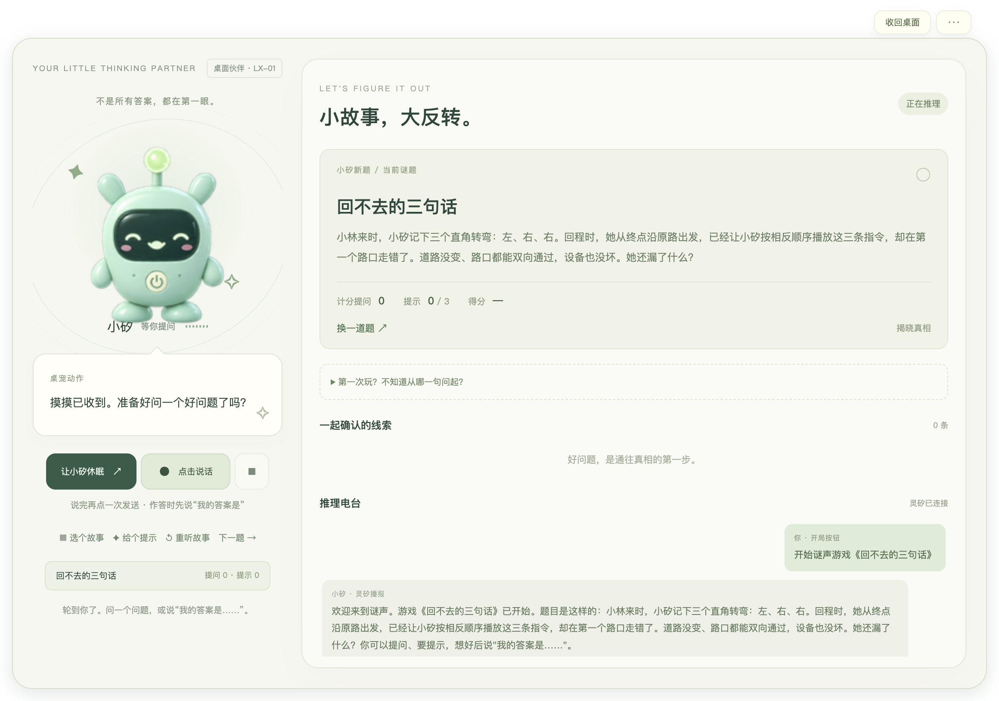

# 谜声 · MISHENG

**和小矽一起，把线索连成真相。**

谜声是一款桌面语音情境推理游戏。听一个不寻常的故事，用“是或不是”的问题逐步确认线索，再说出你的解释。小矽负责守住故事的事实，你负责发现另一种可能。


小矽直接待在桌面上：透明无边框、可拖动、可置顶，空白区域不挡鼠标。平时只露出角色，需要时再展开推理台。



## 一局完整的推理

- **挑一个故事**：8 道内置谜题，包含 3 道项目编写的新题与 5 道经典改编。
- **开口提问**：语音通过灵矽完成识别与播报，也可以随时使用文字。
- **逐步找线索**：查看已确认的问题，按需领取三级提示；不擅自消耗提示。
- **解释真相**：提交完整因果，由服务端结算得分。
- **回看这一局**：按实际问题、判词、提示与作答生成推理回放。
- **带走破案卡**：下载不含谜底、对话或录音的 PNG，分享你的成绩。

 

## 快速启动

源码运行：Node.js 24+（最低 22.13）、pnpm 12。原生桌面应用面向 macOS 13+；已构建的 Mac 应用内置运行时，不需要另外安装 Node.js。

```bash
pnpm desktop:build  # 构建本机架构的 Mac 应用和 ZIP
pnpm desktop:check  # 检查打包应用，不访问平台
```

也可直接从源码启动：

```bash
pnpm install --frozen-lockfile
pnpm pet
```

小矽会出现在桌面角落。点击角色显示操作，选择故事并点击“唤醒并开始”。收到开局确认后，点击说话开始录音，说完再点一次发送。右键可打开菜单，展开推理台后可以文字提问。

语音需要已配置的灵矽 Agent、游戏 MCP 和已绑定设备。首次部署请按 [部署配置](docs/deployment.md) 完成设置；已有 `.env` 和绑定身份时会直接沿用，不需要另外配置独立模型密钥。

```bash
pnpm pet --no-open  # 启动服务，不自动打开窗口
pnpm pet:open      # 打开已运行服务的原生桌宠
pnpm pet:web       # 浏览器入口，需要 Chrome
```

## 第一次怎么玩

1. 从《回不去的三句话》开始，或点“选个故事”。
2. 每次只问一件能回答“是或不是”的事；故事未交代的细节会保留为未知。
3. 需要帮助时点“给个提示”；已经明确问到的方向不会重复收费。
4. 想好后说“我的答案是……”并解释原因，或切到“我要作答”输入文字。
5. 通关后查看回放、保存破案卡，再开启下一题。

建议戴耳机。麦克风只在主动点击后开启；文字指令会等待当前播报结束，方块按钮可显式打断。

## 文档

| 文档 | 内容 |
| --- | --- |
| [原生桌宠](docs/desktop.md) | 透明窗口、拖动、动作、应用构建与配置目录 |
| [使用指南](docs/pet.md) | 录音、文字、提示、结算、回放与常见操作 |
| [故事与玩法](docs/library.md) | 题库分类、提示层级、计分和内容维护 |
| [部署配置](docs/deployment.md) | 环境变量、启动、升级、持久化与反向代理 |
| [灵矽接入](docs/linx-integration.md) | Agent、设备绑定和 MCP 设置 |
| [系统设计](docs/architecture.md) | 音频、可信输入、裁判、状态与安全边界 |
| [维护指南](docs/maintenance.md) | 验证命令、运行诊断、备份与故障处理 |
| [终端客户端](clients/lingxi/README.md) | 可选的 uv/Python 语音终端 |
| [版本记录](CHANGELOG.md) | 功能与行为变更 |

## 运行方式

桌面入口通过本机服务连接灵矽，采用 16kHz 单声道 PCM；不使用浏览器 Speech API 代替灵矽。游戏引擎保存进度与分数，模型不能直接修改结算结果。

桌面端口 `3212` **只供本机使用，不应暴露公网**。公开服务仅部署游戏 API 与 MCP。另保留文字版页面，其浏览器语音辅助与灵矽桌面语音相互独立。

配置保存在运行目录的 `.env`，设备身份位于该目录的 `.local/lingxi-device.json`。源码启动会沿用项目现有配置，Mac 应用可通过菜单选择相同目录；两者都不应进入版本库或交付包。

Mac 构建采用本地 ad-hoc 签名，不是 Apple Developer ID 公证安装包，跨机器首次打开可能需要在系统中确认。

## 验证与交付

```bash
pnpm check        # 题库、服务端与浏览器回归，不调用真实平台
pnpm voice:test   # 可选终端的 Python 回归，需要 uv 与音频依赖
pnpm package     # 从干净的 Git 提交生成源码交付包
```

真实语音检查需显式启用平台访问，命令与覆盖范围见 [维护指南](docs/maintenance.md)。
