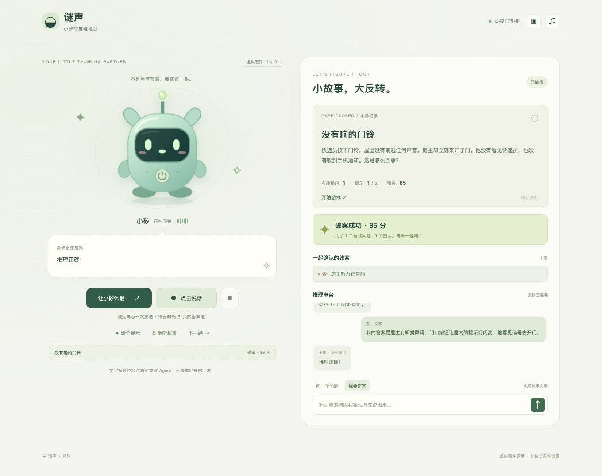
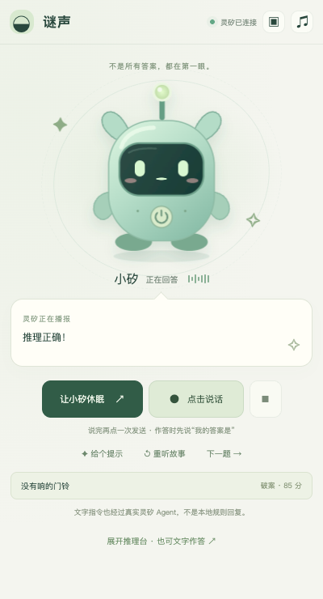

# 谜声 · MISHENG

面向灵矽的语音情境推理游戏。听题、提问、获得提示、提交推理、结算和下一关；单人可玩，多人可围坐参与，不是跑团。

**主入口已改为“小矽桌宠／虚拟硬件演示”。** 在桌面小窗里点击唤醒，听故事、开关麦克风、提问、获得提示并作答；可展开推理台查看真实对话、线索与分数。已通过真实浏览器链路的预录输入 → 灵矽 ASR / Agent / PCM TTS → 85 分结算与换题。

原来的规则网页保留作备用。Agent 主持仍为实验模式，外部独立模型是另一条备选路线；有限冒烟通过不代表完整盲测或安全认证。

- [桌宠玩法、真实验收与边界](docs/pet.md)
- [竞赛版优先级与验收标准](docs/competition-roadmap.md)
- [灵矽接入](docs/linx-integration.md)
- [六轮真实平台实测](docs/playtest.md)
- [复用 Agent 模型的配置、协议与实测](docs/agent-host.md)
- [独立模型评测与延迟阻塞](docs/host-evaluation.md)
- [Mac/Linux 语音终端](clients/lingxi/README.md)

## 环境与启动

Node.js 推荐 24+（最低 22.13），**pnpm 12.0.0**；Python 由 **uv** 管理，`.python-version` 选择 3.12，依赖锁在 `uv.lock`。

```bash
pnpm install --frozen-lockfile
pnpm pet
# 自动检查/复用游戏服务，打开独立 Chrome 桌宠窗口
# 本机入口：http://127.0.0.1:3212/
```

已有灵矽 Agent、MCP 和本机设备配置会沿用；新设备在窗口内获取真实绑定码。桌宠运行不需要 Python / libopus，uv/Python 终端保留作兼容和诊断。桌宠服务只绑定本机，**不要将 3212 加入 frp**；公网上的 `/pet/` 仅为外观预览。





只有一份 Node 锁文件 `pnpm-lock.yaml`，不混用 npm/yarn。Python 使用 `pyproject.toml` + `uv.lock`，不手动 pip 安装。

运行 `pnpm start` 可打开原来的规则备用页面（端口以 .env 为准）。该旧页面不填密钥即可体验 5 道规则关卡。题面不等于谜底，未结束的公共 API 不下发真相和评分规准。网页麦克风与朗读为浏览器 Speech API，**不经过灵矽**；识别结果先填入输入框，检查后发送。浏览器厂商可能处理音频，请勿输入敏感内容。

## 不用专用硬件：Mac 连接真实灵矽

```bash
brew install opus
pnpm voice:setup      # uv sync --locked；依赖放在 .venv，不改系统 Python
pnpm voice:check      # 原生 Opus 和音频设备自检，不录音
pnpm voice:activate   # 获取绑定码，添加到现有 Agent
pnpm voice:probe      # 真实 WSS 握手，不录音
pnpm voice:smoke      # 合成“开始游戏”检查 ASR/TTS，不打开麦克风
pnpm voice:playtest   # 同一会话九轮 Agent 主持冒烟，不使用麦克风/扬声器
pnpm voice:start      # 回车开始录音，再次回车结束；q 退出
```

状态文件 `.local/lingxi-device.json` 权限 0600，设备 token 只在内存中。Agent 需要配置游戏 MCP、支持工具调用的模型和角色提示词。详见终端文档。已完成的六轮实测使用合成语音，不代表实际麦克风、扬声器、噪声、打断和重连均已验收。

## MCP

仅支持 **Streamable HTTP `POST /mcp`**，Normal 认证模式下配置：

```text
Authorization: Bearer <LINX_SERVICE_TOKEN>
```

工具：`mystery_catalog`、`mystery_turn`；开启 Agent 主持后增加 `mystery_commit`。GET/DELETE `/mcp` 返回 405，旧 SSE 端点已删除。每次游戏调用需要平台自动传入设备/会话标识；查询工具不需要设备身份。

部署实例 `https://placid.cyou/mcp` 依赖本机 3000 端口服务和 frp 持续在线。GitHub 仓库地址不是服务 URL。

```bash
cp .env.example .env  # 已有 .env 时不要覆盖
# 配置 LINX_SERVICE_TOKEN、PUBLIC_ORIGIN 后启动服务
pnpm mcp:check
```

服务令牌、灵矽管理账号 token、设备 token、模型 key 各自独立，不能互换。密钥只保存在服务端 `.env` 或部署环境。

## 首选：复用灵矽 Agent 模型

```ini
LINX_AGENT_HOST_ENABLED=1
AI_HOST_ENABLED=0
```

MCP 在 turn 阶段提供内部主持资料，Agent 提交结构化 judgment，commit 阶段校验证据、玩家引文、请求版本并由状态机结算；这条路径不调用独立模型 API。平台需刷新工具并使用 [新提示词](docs/agent-host-prompt.txt)，操作见 Agent 主持文档。

私有资料会进入 Agent/平台上下文，不是安全隔离字段；仍可能被模型泄露或错误判定。本轮一条攻击样本未泄露，不代表抗注入认证。网页不提供这份内部资料。

## 可选：独立模型裁判（真实评测尚未达标）

在 `.env` 配置 OpenAI-compatible 服务的 `LLM_BASE_URL`（基础 /v1 或完整 /v1/chat/completions 地址均可）、`LLM_API_KEY`、`LLM_MODEL`，先保持 `AI_HOST_ENABLED=0`：

```bash
pnpm eval:host
# 配置缺失退出 2，表示没有执行模型质量评测，而不是通过
```

开发评测集覆盖 5 关、未知细节、否定、多问题、注入、错误因果和堆词判题。目标总体 ≥95%，安全样本 100%；开发集通过还需独立盲测，报告存入忽略的 `eval-results/`。门槛和排期见竞赛路线图。

当前真实接口评测受超时阻塞，详见评测报告，不要直接打开 AI 模式。可选 `LLM_REASONING_EFFORT` 只在供应商支持时设置，留空使用供应商默认值；low 在本次试验中未证实改善。

真实质量与延迟达标后再设 `AI_HOST_ENABLED=1` 并重启：

- 读取固定真相，只输出是/否/无关/无法确定/澄清/拒答，不扩展整条事实。
- 是/否需要合法内部证据，证据不发给玩家；合法证据 ID 不等于语义正确，仍需真实评测。
- 按独立因果规准和玩家原文引文判题；状态机决定通关，模型不能直接修改状态。
- 模型异常/超时/无效输出，不退回会剧透的关键词答案，不扣提问或提交次数。
- 未记载细节、澄清和安全拒答不扣提问次数。
- AI 不可用时提示、重听等确定性操作仍可用。

不开启 AI 时仍是旧规则演示：只做有限关键词匹配，可能连带泄露关键事实；判题可能误拒复杂正确表达或被堆词绕过，不适合竞技。新模型测试中的 mock 只验证程序约束，不证明真实模型的理解/抗注入能力。

## 测试

```bash
pnpm test          # 引擎、主持结构校验、HTTP/MCP 集成
pnpm test:e2e      # 原网页 + 桌宠完整/小窗流程，使用模拟 Agent
pnpm voice:test    # uv 下的 Python 测试，含本机 libopus 编解码
pnpm eval:host     # 配置真实模型后运行，可能产生 API 费用
pnpm pet:check --allow-platform # 真实桌宠界面验收，预录输入，不采集物理麦克风
```

依赖锁文件可复现安装。缺少 libopus 时 Python 原生编解码测试会跳过，不等于本机音频已通过。真实平台语音诊断会消耗少量平台资源。

## 部署与边界

```bash
docker build -t linx-mystery .
docker run --rm -p 127.0.0.1:3210:3210 --env-file .env \
  -e HOST=0.0.0.0 -e DB_PATH=/app/data/games.sqlite \
  -v misheng-data:/app/data linx-mystery
```

Dockerfile 使用 pnpm frozen lockfile，镜像构建/运行尚未实测。对外由反向代理提供 HTTPS，设置准确的 `PUBLIC_ORIGIN`。服务默认只监听本机，平台端点未设置令牌时关闭。

另保留非 MCP 的第三方业务 `POST /api/chat/stream` SSE 回调，使用时需关闭代理缓冲。不能把它当作 MCP URL 或 OpenAI API。

初版为单实例小流量：SQLite 持久化，基础直连 IP 限流；仍需正式部署保活、可信代理、数据清理、备份和监控。清理网页 cookie 后无法恢复原进度。数据库含文字和进度，不保存录音。

## 代码

```text
src/cases.js          固定谜题、审核事实、提示和评分规准（服务端）
src/host.js           AI 裁判、输出与引用校验
src/engine.js         状态、计分、持久化、规则与 AI 模式
src/server.js         游戏 API、Streamable HTTP MCP、认证
src/pet-server.js     本机语音桥，设备 token 不进入浏览器
src/device-view.js    设备状态投影与实际输入登记
public/pet/           桌宠界面、Web Audio / AudioWorklet PCM
public/               保留的旧规则网页
clients/lingxi/       同仓库 Python 音频终端
scripts/              uv 启动器、MCP 检查、模型评测
eval/                 人工标注的开发评测集（不是独立盲测）
test/、e2e/           程序与网页回归
docs/                 接入、实测、竞赛路线图
```
