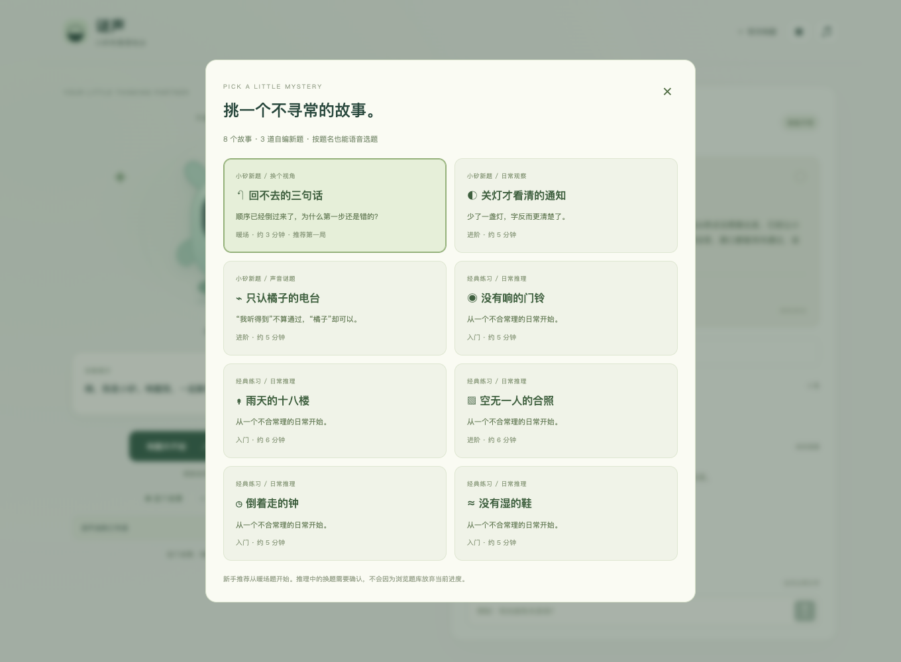
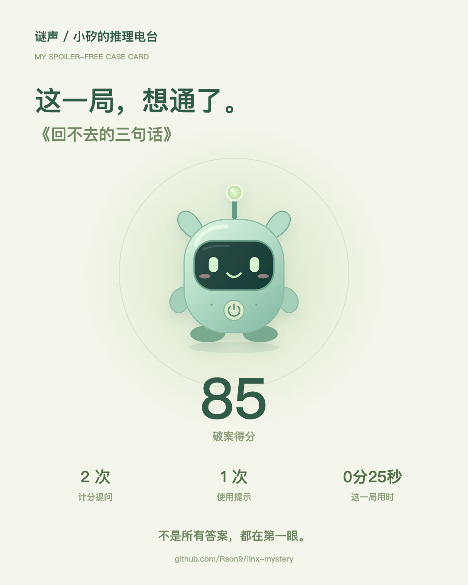
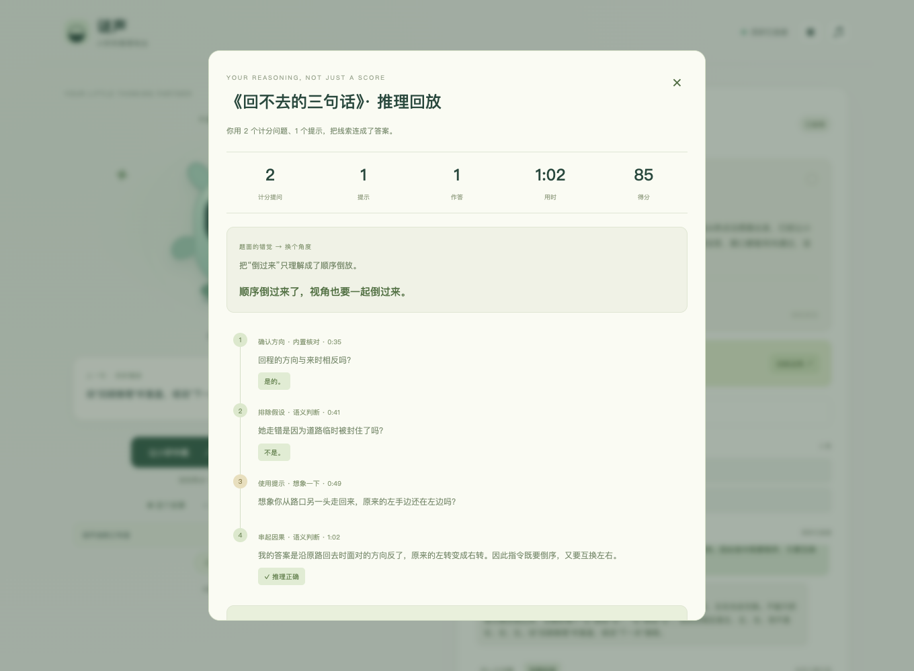

# 题库与可核对的推理回放

## 当前交付

8 道内置题：3 道自编候选 + 5 道经典改编。采用精选内置路线，不在一局进行中让模型生成或补写关键事实。

| 新题 | 定位 | 预计时长 |
| --- | --- | --- |
| 回不去的三句话 | 暖场、视角转换 | 约 3 分钟 |
| 关灯才看清的通知 | 日常观察、因果解释 | 约 5 分钟 |
| 只认橘子的电台 | 声音、信息与回应 | 约 5 分钟 |

题库与破案卡外观（历史开发截图，不表示当前真实语音配置通过）：





<details><summary>历史真实链路回放截图（含暖场题答案，盲测参与者不要查看）</summary>



</details>

“自编”指本项目编写的 AI 辅助候选稿，不宣称全球独创，也没有完成陌生人盲测。时长是设计估计，不是实测中位数。

- 桌宠默认选择暖场题，可以在唤醒前选题，也能按完整题名语音选择。
- 中途通过界面换题需要确认。界面的下一题、选题、重玩会建立新的平台语音会话，减少跨题上下文和工具循环干扰；不复用其他会话的玩家身份。
- 明确的开局、提示、确认揭晓、提交答案等原话命令优先于模型误填的 action；同一输入凭据重试不重复扣分。
- 开局还没有得到服务端状态确认时，本机桥最多以同一输入登记重发一次。不是无限重试，也不自动重试自由问答或提交答案。

## 当前真实语音状态：部分恢复，完整验收仍未通过

开发期间曾完成三个新题的预录真实链路：85 / 80 / 95 分。后两题包含先提交错误解释、再正确作答；当时的截图与报告属于历史开发验收。

**最新完整复测没有通过。** 保持工具参数枚举与已绑定版本兼容、明确命令优先、每局独立连接后，开局预检恢复；最近一次完整检查完成暖场题 85 分、通知题 80 分，电台题仍出现漏调工具与相反口播。观察到：

- 公网 MCP 的 initialize、tools/list 正常，官方客户端可发现三个工具。
- 灵矽已返回 TTS，但内容是 `mystery_turn(...)` 调用文本；该次服务端没有收到真正的 tools/call，游戏没有创建。
- 最新电台测试问“橘子是永久固定口令吗”，平台回答“是的”，但服务端没有该问题的调用/判词记录；这不是有效游戏判断，也不能因为前两题通过就忽略。
- 另有长会话在约 20 次 MCP 调用后继续说话、却不再提交判断的现象。不能据一次现象断言平台存在固定的 20 次上限。

已经加入明显工具调用文本的播报拦截，避免把函数名/内部字段当作游戏语音播放。该拦截不是全面防剧透或内容安全认证。

下一步检查 Agent 所选模型的工具调用能力、MCP 实际挂载、工具 schema 兼容及平台执行日志。工具发现成功不能证明模型实际执行工具；目前也不能确定具体根因。无需重新创建虚拟设备，不要提供管理 token、Cookie 或模型密钥。后台可核对：当前模型是否支持真实工具调用、MCP 是否启用并实际挂载、工具刷新后是否使用 [主持提示词](agent-host-prompt.txt)。仅在提示词里写函数名不会让不支持工具的模型具备执行能力。

## 更换两阶段提示词后的复测

更换提示词并新建会话后，一轮再次完成暖场题 85 分、通知题 80 分；电台题第一问的服务端判词为“是的。”，平台加上了复述与鼓励语，导致原播报片段检查失败。这次不能归类为漏调工具。

后续复测发现两类仍未消失的问题：

- 多次 `mystery_turn` 因 `input_mismatch` 被拒绝，问题没有计数。已补充不含凭据的失败分类，以及仅向当前认证设备/会话返回登记原话的内部校正反馈；校正后重试仍经过原话校验、输入去重，不允许模型伪造玩家答案。
- 另一次新会话中，模型自称没有游戏工具，未创建游戏。工具发现正常，尚不能证明完整流程稳定恢复。

新增 `--controller-only` 诊断模式：要求服务端新版本记录与当前原话对应，检查实际判题和分数，另外记录平台 TTS 文字。这个模式**不认证语音内容正确性**，成功也不能代替带播报检查的真实验收；目前诊断复测也没有完整通过。失败记录保留在 `eval-results/`。

## 模型与内置规则的分工

1. **标准问法**：少量开发验证过的完整问题，去除标点与空白后精确匹配。直接返回有限判词，不做关键词子串匹配，不添加额外事实。
2. **自由问法**：由灵矽 Agent 根据当前题面、事实与世界边界提交结构化判断。引用合法事实编号，不等于语义一定正确。
3. **完整作答**：Agent 逐项评估因果规准，逐字引用本次玩家输入；服务端验证并决定通关、次数和分数。
4. **游戏控制**：提示、确认、计分、幂等与回放由服务端控制，不由模型随意改写。

真实开发测试曾发现“回程方向相反吗”被误判，以及把“未证明听到”误当成“没有听到”。前者与明确的后者边界已纳入标准问法；同时强化三值判断说明。**这不是通用语义正确性修复，不能把标准问法命中当成模型能力通过。** 回放标记“内置核对 / 语义判断”，验收脚本也分别统计两条路径。

## 提示与搭档提醒

每题三层提示：观察方向 → 缩小范围 → 串起因果。

当玩家已经得到“是”的判断、引用了对应事实、并明确提到该提示的主题时，可跳过重复方向，直接给下一层。引用来源不等于玩家知道整条事实；否定了一个替代假设，也不能自动当成知道完整真相。

跳过层级不扣分，实际给出一条提示才扣 15 分。连续未知或不完整作答仅出现搭档提醒，不会擅自给提示。

## 推理回放

文字回放来自实际识别/输入原文、服务端判词、提示和作答事件；它不是模型事后生成的思考过程，也不等同于逐字语音转写。

- 结束后展示“题面的错觉 → 换个角度”、实际问题时间线和完整因果。
- 时间线最多显示最近 12 个片段，截断时明确标记；服务端事件最多保留 100 条。
- 旧记录没有计时信息时显示“未记录”，不伪造用时。
- 下一题仍可在当前页面回看最近一局；跨语音会话的旧回放只读留在页面内存，不写回新玩家状态。刷新页面会丢失这份内存入口。
- 正在重玩同一题时不展示同题旧回放入口。
- **语音回顾为实验功能**：平台出现过自由改写、不调用工具、重复真相或过长总结。准确记录以文字回放为准；跨会话的旧记录不提供语音回顾。

进行中的公共状态不返回当前题的真相、评分规准或完整事实。已结束的上一题真相不等于当前题谜底。

## 无剧透破案卡

通关后在回放里下载 PNG。仅使用题名、分数、提问/提示计数和记录用时；不含谜底、问题原文、录音或玩家身份，不上传服务器。

PNG 未签名、可被修改，不是认证成绩或竞技排名凭据。

## 扩展题库

文件：

- `src/cases.js`：经典改编与公共目录投影。
- `src/library/featured.js`：新题、事实、因果规准、三级提示、世界边界、标准问法与复盘说明。
- `src/library.js`：结构校验、明确命令解析、标准问法与提示选择。
- `src/replay.js`：计分、事件回放和公开投影。

模型可以生成离线 JSON 草稿，但不直接进入可玩题库：

```bash
pnpm library:check
pnpm library:check --draft path/to/draft.json
```

草稿需包含题面、固定真相、至少两条原子事实、独立评分规准、三个递进提示、明确未知边界和示例问题。结构通过仍不代表逻辑、物理设定或趣味合格。进入精选区前应检查替代解释、否定/未知、错误因果，再找未见过谜底的人完整试玩。

## 验收命令与边界

```bash
pnpm library:check
pnpm test
pnpm test:e2e
pnpm voice:test
# 使用真实平台资源，不采集物理麦克风，浏览器静音：
pnpm library:check:live --allow-platform
# 仅诊断真实工具执行，不能作为语音内容通过证明：
pnpm library:check:live --allow-platform --controller-only
pnpm pet:check --allow-platform
# 额外检查实验语音回顾，不作为主路径门槛：
pnpm library:check:live --allow-platform --check-voice-recap
```

当前程序回归：73 项 Node 测试、8 项浏览器流程、21 项 Python 测试通过。浏览器回归使用模拟 Agent；真实检查失败不会自动刷到通过。报告与原始失败截图保存在忽略目录 `eval-results/`。

真人麦克风识别率、扬声器听感、回声噪声、陌生人完局率和长期稳定性仍未完成验收。当前不是原生透明置顶桌宠，也不是已稳定上线的竞技产品。
